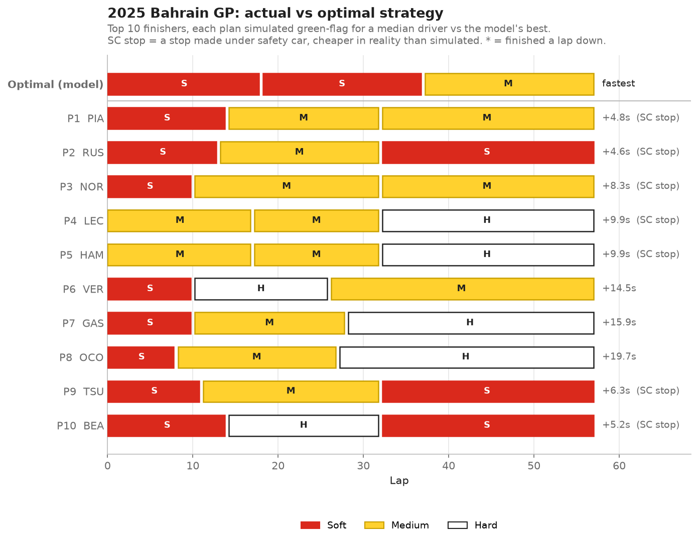

# F1 Tyre Degradation & Pit Strategy Predictor

Fits tyre degradation from real 2025 F1 lap data, simulates every 1- and 2-stop strategy, and compares the result with what the top 10 actually did.



## What it does

- Loads race laps, weather and track status with [FastF1](https://github.com/theOehrly/Fast-F1) for three dry 2025 races: **Bahrain** (high degradation), **Hungary** (medium) and **Japan** (low).
- Fits a degradation model per race: seconds lost per lap of tyre age for each compound, plus fuel burn-off.
- Estimates pit stop time loss from real in-laps and out-laps.
- Searches about 10,000 strategies per race in under a second and ranks them by race time.
- Simulates each top-10 finisher's real strategy and compares it with the model's optimum.
- Includes a Streamlit app to explore each race and change the pit loss.

## Approach

**Data → cleaning → degradation model → pit loss → simulator → comparison**

1. **Cleaning** ([src/cleaning.py](src/cleaning.py)) keeps only green-flag laps that represent normal race pace. It drops lap 1, in-laps and out-laps, SC/VSC/yellow/red laps, deleted or inaccurate laps, and laps more than 7% slower than the driver's stint median. Track temperature is merged in from the weather feed. 82–93% of laps survive.
2. **Degradation model** ([src/models.py](src/models.py)) is a linear regression per race:
   `lap_time = base_pace[compound] + driver_offset + deg_rate[compound] × tyre_age + fuel_effect × lap_number`.
   Driver offsets are one-hot encoded so fast drivers don't distort the degradation rates. The fuel effect is shared across compounds. It can't be fitted per compound, because tyre age and lap number move together within a stint.
3. **Pit loss** ([src/pit_loss.py](src/pit_loss.py)) compares in-lap + out-lap time with the driver's normal laps around the stop. Stops under SC/VSC are excluded, and the result is the median across drivers.
4. **Simulator** ([src/simulator.py](src/simulator.py)) enumerates every strategy that uses at least two dry compounds, with a minimum stint of 8 laps. Stints are capped at the longest stint actually run on that compound, so the linear model is never extrapolated past the data. Stint times come from a precomputed lookup table.
5. **Comparison** ([src/actual_strategies.py](src/actual_strategies.py)) extracts each finisher's real compounds and pit laps. It simulates them with the same green-flag, median-driver model, so the delta reflects strategy only, not driver pace.

## Key results

**The simple model beat machine learning.** Both models were evaluated on 20% of stints held out whole (split by stint, not by lap, to avoid leakage), and on leave-one-race-out:

| MAE (s) | Bahrain | Hungary | Japan |
|---|---|---|---|
| Linear baseline, held-out stints | **0.49** | **0.57** | **0.29** |
| Gradient boosting, held-out stints | 0.56 | 0.66 | 0.43 |
| Linear baseline, unseen race | **0.60** | **0.75** | **0.51** |
| Gradient boosting, unseen race | 0.66 | 0.77 | 0.63 |

The gradient boosted model overfits. Its MAE is 0.23 s on training data and about 0.56 s on held-out stints. With roughly 3,200 clean laps, a model with physical structure generalises better. Adding a quadratic tyre-age term didn't help either.

**Fitted parameters**

| | Soft | Medium | Hard | Fuel effect | Pit loss |
|---|---|---|---|---|---|
| Bahrain | 0.127 s/lap | 0.103 | 0.122 | −0.064 s/lap | 23.2 s |
| Hungary | 0.041 | 0.049 | 0.047 | −0.049 | 21.4 s |
| Japan | 0.059 | 0.051 | 0.031 | −0.077 | 23.4 s |

**Strategy findings**

- **Japan:** the model picks a one-stop with the medium/hard pair. The top 10 all ran that pair, and 9 of them finished within 0.4 s of the model's optimum.
- **Hungary:** the model rates one-stop and two-stop as nearly equal (0.4 s apart). The real top 10 were split the same way, all within 2.5 s except a lapped Antonelli.
- **Bahrain:** a two-stop is 8.7 s faster than the best one-stop. Most teams took their second stop under the lap-32 safety car, which the simulator charges at full green-flag pit loss. Their 4–10 s deltas are therefore an upper bound.

## Limitations

- **Three races only.** The degradation rates are specific to these races and conditions.
- **No safety cars, traffic, tyre warm-up or undercut/overcut.** Every race is simulated as fully green with clean air.
- **Stint order doesn't matter in this model.** With an additive fuel term, S-M-H and H-M-S with the same stint lengths take identical time.
- **Sparse compounds are noisy.** Soft didn't always come out as the fastest-degrading compound. In Hungary only 42 clean soft laps exist, so a soft stint in the "optimal" plan there should be read with care.
- **Real tyre history is ignored.** Every stint is assumed to start on fresh tyres, though real starting sets are sometimes used from qualifying.

## Next steps

- Model safety car probability and cheaper pit stops under SC (Monte Carlo over SC timing).
- Add a tyre warm-up penalty for the first laps of a stint, plus traffic and track position.
- Fit across many races with track-level features, so degradation can be predicted for a race before it happens.

## How to run

```bash
python -m venv .venv
.venv\Scripts\activate          # macOS/Linux: source .venv/bin/activate
pip install -r requirements.txt

python -m src.race_summary          # check the chosen races were dry
python -m notebooks.eda             # exploratory plots -> figures/eda/
python -m src.evaluate              # baseline vs gradient boosting
python -m src.actual_strategies     # top-10 actual vs optimal tables
python -m src.plots                 # all charts -> figures/
streamlit run app.py                # interactive app
pytest                              # tests
```

The first run downloads race data from FastF1 into `data/cache/`, which takes a minute or two per race.
